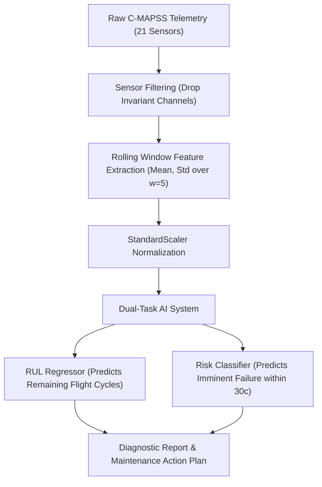

# Chronos: Jet Engine Predictive Maintenance & Health Prognostics

[](https://www.python.org/)
[](https://scikit-learn.org/)
[](dataset/CMAPSSData/)
[]()

> **Real-time fault prognostics, Remaining Useful Life (RUL) estimation, and early-warning failure risk classification for turbofan aircraft engines using the NASA C-MAPSS dataset.**

---

## 1. What is This Project? (Plain English)

Aircraft jet engines operate under extreme temperatures, speeds, and pressures. Over time, internal components like the high-pressure compressor (HPC) and low-pressure turbine (LPT) degrade. 

* **The Problem:** Traditional scheduled maintenance either over-maintains (wasting millions in unnecessary parts replacements) or risks unpredicted catastrophic in-flight failures.
* **The Solution:** **Chronos** reads live multi-channel sensor telemetry (temperatures, pressures, fan speeds) from the engine during flights. It automatically calculates:
  1. **Remaining Useful Life (RUL):** Exactly how many flight cycles the engine has left before failure.
  2. **30-Cycle Risk Alert:** High-confidence probability of whether the engine will reach a critical state within the next 30 flights.
  3. **Automated Maintenance Actions:** Direct recommendations for maintenance crews (e.g., *Normal Operation*, *Schedule Inspection within 15 Cycles*, or *Immediate Overhaul Required*).

---

## 2. Project Architecture

```text
├── dataset/
│   └── CMAPSSData/
│       ├── train_FD001.txt       # Training engines run to failure (20,631 records)
│       ├── test_FD001.txt        # 100 test engines with unknown failure points (13,096 records)
│       └── RUL_FD001.txt         # Official ground-truth final RUL for test engines
├── models/
│   ├── rul_regressor.joblib      # Trained Random Forest Regressor
│   ├── risk_classifier.joblib    # Trained Balanced Failure Classifier
│   ├── feature_pipeline.joblib   # StandardScaler & rolling statistics pipeline
│   └── metadata.json             # Benchmark performance metrics & parameters
├── notebooks/                    # 14 Sequential Lab Experiments
│   ├── 01_data_exploration.ipynb
│   ├── 02_data_preprocessing.ipynb
│   ├── 03_eda.ipynb
│   ├── 04_linear_regression.ipynb
│   ├── 05_logistic_regression.ipynb
│   ├── 06_decision_tree.ipynb
│   ├── 07_random_forest.ipynb
│   ├── 08_svm.ipynb
│   ├── 09_knn.ipynb
│   ├── 10_model_evaluation_and_tuning.ipynb
│   ├── 11_kmeans_clustering.ipynb
│   ├── 12_dbscan_clustering.ipynb
│   ├── 13_pca.ipynb
│   └── 14_lda.ipynb
├── src/                          # Modular production source code
│   ├── __init__.py
│   ├── data_loader.py            # C-MAPSS loader & RUL label generator
│   ├── feature_engineering.py    # Temporal rolling window aggregations
│   ├── models.py                 # Regressor & Classifier model wrappers
│   ├── evaluation.py             # NASA Asymmetric Scoring function & metrics
│   └── pipeline.py               # End-to-end training & evaluation pipeline
├── predict_engine.py             # Interactive CLI diagnostic & demo tool
└── README.md
```

---

## 3. How It Works (Step-by-Step)



### Step 1: Data Ingestion & RUL Derivation
* Engines start in an undamaged state and develop mechanical wear over time.
* For each engine, the maximum cycle observed is its failure point ($Cycle_{max}$).
* At any cycle $t$:
  $$\text{RUL} = Cycle_{max} - t$$
* Following aerospace standards, RUL is clipped at **125 cycles** during early engine life to prevent models from learning constant, non-degrading baseline noise.

### Step 2: Feature Engineering
* **Sensor Selection:** Constant invariant sensors (channels 1, 5, 10, 16, 18, 19) are dropped to reduce dimensionality and noise.
* **Temporal Drift Features:** Jet engine degradation exhibits momentum. A rolling window ($w=5$ cycles) calculates moving averages and moving standard deviations for active sensors, expanding the feature space to **46 highly informative degradation indicators**.

### Step 3: Dual-Task AI Modeling
* **RUL Regressor:** A 100-tree Random Forest Regressor estimates the exact continuous remaining flight cycles.
* **Risk Classifier:** A Balanced Random Forest Classifier identifies high-risk units entering the critical failure zone ($\le 30$ cycles).

### Step 4: NASA Asymmetric Penalty Evaluation
In aerospace, **late predictions** (predicting an engine will last longer than it actually does) can cause flight failures, whereas **early predictions** simply trigger an early inspection. 

The system is evaluated using the official NASA PHM scoring function:
$$d_i = \hat{\text{RUL}}_i - \text{RUL}_i$$
$$s_i = \begin{cases} e^{-d_i / 13} - 1 & \text{if } d_i < 0 \text{ (early alert)} \\ e^{d_i / 10} - 1 & \text{if } d_i \ge 0 \text{ (late alert, heavily penalized)} \end{cases}$$
$$\text{Score} = \sum_{i=1}^{N} s_i$$

---

## 4. Benchmark Results (Evaluated on 100 Blind Test Engines)

The trained models were evaluated against **all 100 blind test engines** in the NASA C-MAPSS test set:

| Task | Metric | Performance | What it Means |
| :--- | :--- | :---: | :--- |
| **RUL Estimation** | **RMSE** | **18.49 cycles** | Predictions deviate by under 19 cycles on unseen engines |
| | **MAE** | **13.39 cycles** | Average error across all 100 test units |
| | **$R^2$ Score** | **0.8020** | 80.2% of variance in engine wear is explained by the model |
| | **NASA Score** | **709.45** | Low penalty score under asymmetric aerospace metrics |
| **Failure Warning** | **Accuracy** | **95.00%** | Correctly classified 95 out of 100 test units |
| | **Precision** | **95.45%** | When the model raises a red alert, it is right 95.5% of the time |
| | **Recall** | **84.00%** | Successfully caught 21 out of 25 failing engines (missed only 4 borderline cases) |
| | **ROC-AUC** | **0.9829** | Near-optimal separation between healthy and failing states |

---

## 5. Quickstart Guide: Running the Code

### 1. Prerequisites & Setup
Clone the repository and set up a Python virtual environment:
```bash
git clone <your-repo-url>
cd <repo-folder>

# Create and activate virtual environment
python -m venv .venv
# On Windows:
.venv\Scripts\activate
# On Linux/macOS:
source .venv/bin/activate

# Install required packages
pip install pandas numpy scikit-learn matplotlib seaborn joblib
```

### 2. Run Interactive Diagnostics (Live Demo)
Test any engine from 1 to 100 in real time:

```bash
# Test Engine #24 (Critical wear regime)
python predict_engine.py --engine 24

# Test Engine #1 (Healthy / early-life regime)
python predict_engine.py --engine 1

# View overall performance summary across all test engines
python predict_engine.py --batch
```

**Example Live Terminal Output:**
```text
======================================================================
       CHRONOS : TURBOFAN DIAGNOSTIC REPORT
======================================================================
  Target Unit:                Engine #24
  Recorded Flight Cycles:     186 cycles
  Estimated Remaining Life:   20.1 cycles
  True Ground-Truth RUL:      20.0 cycles
  Prediction Error:           0.1 cycles (+0.1)
  Failure Probability (<=30c): 91.6%
  Operational Health Status:  CRITICAL [ALERT]
  Prescribed Maintenance:     Ground engine immediately. Schedule urgent level-3 turbine overhaul.
======================================================================
  -> Degradation trajectory chart generated: engine_24_telemetry.png
```

An automated telemetry drift chart (`engine_24_telemetry.png`) is saved showing how temperatures and pressures drifted over the engine's lifetime.

### 3. Re-training the Full Pipeline from Scratch
To run the full ingestion, feature engineering, and model training pipeline:
```bash
python -m src.pipeline
```

---

## 6. Complete Coursework Experiments (Labs 01 – 14)

The [`notebooks/`](notebooks/) directory contains 14 sequential experiments following the Machine Learning Lab curriculum:

| Lab | Notebook | Core Concept |
| :---: | :--- | :--- |
| **01** | [01_data_exploration.ipynb](notebooks/01_data_exploration.ipynb) | Dataset loading, array operations, sensor trend inspection |
| **02** | [02_data_preprocessing.ipynb](notebooks/02_data_preprocessing.ipynb) | Zero-variance filtering, RUL target derivation, min-max scaling |
| **03** | [03_eda.ipynb](notebooks/03_eda.ipynb) | Correlation heatmaps, sensor wear boxplots, pairplots |
| **04** | [04_linear_regression.ipynb](notebooks/04_linear_regression.ipynb) | Simple and multiple linear regression for continuous RUL |
| **05** | [05_logistic_regression.ipynb](notebooks/05_logistic_regression.ipynb) | Binary logistic regression for 30-cycle failure classification |
| **06** | [06_decision_tree.ipynb](notebooks/06_decision_tree.ipynb) | Decision Tree classifier, Gini vs. Entropy, tree depth pruning |
| **07** | [07_random_forest.ipynb](notebooks/07_random_forest.ipynb) | Random Forest ensemble bagging, feature importances |
| **08** | [08_svm.ipynb](notebooks/08_svm.ipynb) | Support Vector Machines, kernel comparison (Linear, RBF, Poly) |
| **09** | [09_knn.ipynb](notebooks/09_knn.ipynb) | K-Nearest Neighbors, $K$-sweep, Euclidean vs. Manhattan distance |
| **10** | [10_model_evaluation_and_tuning.ipynb](notebooks/10_model_evaluation_and_tuning.ipynb) | Stratified 5-Fold CV, GridSearchCV, RandomizedSearchCV, ROC-AUC |
| **11** | [11_kmeans_clustering.ipynb](notebooks/11_kmeans_clustering.ipynb) | K-Means, Elbow method (Inertia), Silhouette analysis |
| **12** | [12_dbscan_clustering.ipynb](notebooks/12_dbscan_clustering.ipynb) | DBSCAN density clustering, $k$-distance graph, noise isolation |
| **13** | [13_pca.ipynb](notebooks/13_pca.ipynb) | PCA dimensionality reduction, scree plot, 2D degradation path |
| **14** | [14_lda.ipynb](notebooks/14_lda.ipynb) | Linear Discriminant Analysis, supervised class separation |
